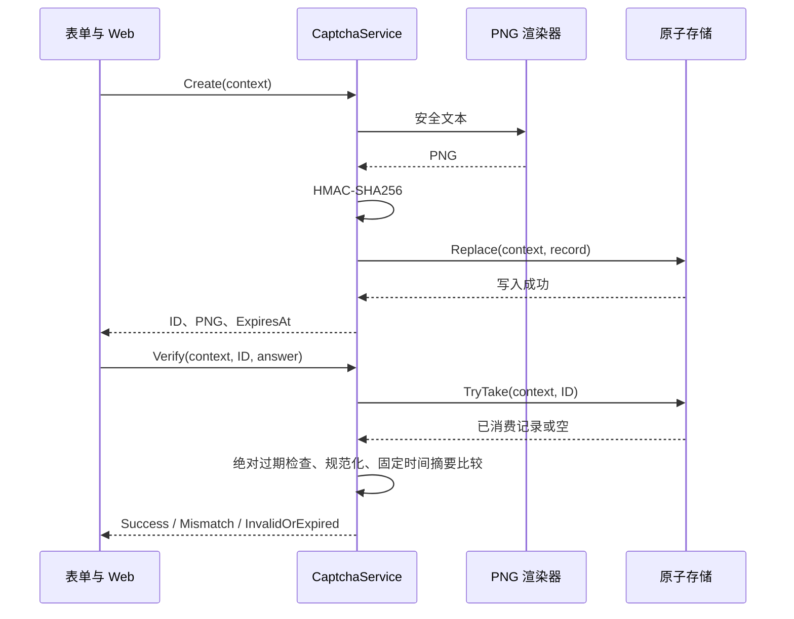

# 验证码完整能力方案

2026-10-29 按已确认实施计划修订。本文件取代早期草案的重复渲染配置、故障枚举与取消语义。实施清单及测试证据保存在 [任务目录](../../../ai_docs/tasks/2026-10-28-captcha-lifecycle/plan.md)。

## 目标与拆包

交付生成、PNG 展示、存储、校验、刷新、绝对过期和一次性消费，支持数字、去歧义字母数字及中文白名单。四包均支持 net8.0、net7.0、net6.0、netstandard2.0。

| 包 | 职责 | 依赖 |
| --- | --- | --- |
| Captcha | 生命周期、安全摘要、不可变契约、有界内存、指标 | Security、Drawing.Shared、DiagnosticSource 8.0.1 |
| Captcha.SkiaSharp | PNG、字体复用及中文覆盖检查 | Captcha、Drawing.SkiaSharp |
| Captcha.Redis | 原子替换和消费、有界序列化 | Captcha、StackExchange.Redis 2.13.1 |
| Captcha.DependencyInjection | 唯一组件选择、配置快照、资源所有权 | Captcha、DI Abstractions 8.0.2 |

包名统一带 `Bing.Utils.` 前缀；各模块的最终 API 见 [生命周期入口](../../modules/Bing.Utils.Captcha.md)。旧 System.Drawing/ImageSharp 不进行全面改造。

## 公共契约

```csharp
Task<CaptchaChallenge> CreateAsync(CaptchaContext context,
    CancellationToken cancellationToken = default);

Task<CaptchaVerifyResult> VerifyAsync(CaptchaContext context,
    string captchaId, string answer,
    CancellationToken cancellationToken = default);
```

Context 的 Purpose 由业务固定；BindingId 由服务端可信会话产生；FlowId 区分表单和标签页。三个字段全部参与隔离和认证。字段非空、无控制字符/UTF-16 代理项，最大长度分别 64/256/128。

Renderer 接收文本及取消令牌，同步返回 PNG 字节、媒体类型和尺寸；渲染配置仅存在于适配器快照。Store 提供 ReplaceAsync 原子替换和 TryTakeAsync 按 ID 原子取出并删除，错 ID 不删除新挑战。

VerifyStatus 仅有 InvalidOrExpired=0、Success、Mismatch。基础设施故障抛专用 CaptchaStoreException/CaptchaRendererException；取消抛 OperationCanceledException，不能当作普通答案错误或放行业务。只读模型复制图片、摘要、密钥及配置数据，默认 ToString 不打印敏感内容。

## 默认与边界

| 项目 | 约束 |
| --- | --- |
| 文本 | 默认 5 位去歧义大写字母数字，允许 4～8 位 |
| 有效期 | 默认 120 秒，30～300 秒，绝对过期 |
| ID | 16 字节安全随机数、Base64Url，默认 22 字符 |
| 图像 | PNG 160×60，最多 512×256，默认 64 KiB |
| 答案 | 原始及 FormKC 结果均最多 64 字符，Trim，ASCII 大小写可配置 |
| 内存 | 默认 10000 条，容量可配置，非性能承诺 |
| 消费 | 当前 ID 的一次合法格式尝试即消费，答案错误也消费 |

## 生命周期与安全



创建顺序：校验配置和上下文 → 安全随机文本/ID → 渲染 → 摘要 → 存储 → 返回。渲染失败保留旧记录。按最后成功写入的挑战作为当前记录。

校验先验证请求格式，之后原子取出，再检查 `UtcNow >= ExpiresAt`，最后按记录中的策略和密钥版本计算摘要。格式错误不消费；消费后业务失败也必须刷新。读取、错误或重试不会续期。

HMAC 认证输入包含领域标识、三个上下文字段、ID、毫秒级过期时间、规范化版本、大小写规则、密钥版本及规范化答案；全部使用长度前缀 UTF-8 编码。比较使用现有 Security 固定时间实现。密钥提供器原子返回版本和材料，至少 32 字节；生产密钥由宿主管理。轮换保留旧版本至少覆盖最后发放后的最大有效期。

## 适配器与资源

内存字典和链表在短锁下替换/消费，锁外绘图和密码学计算。满容量先清过期再淘汰最旧记录；后台分批清理，正确性仍由访问检查保障。Dispose 停止定时清理并清空状态。

SkiaSharp 每请求创建画布和画笔，字体在构造时复用，释放临时图片及编码对象。中文必须配置字体，并检查完整白名单覆盖。分配前检查尺寸、字体大小、噪声和未实现设置，编码后检查字节数。旧绘图入口保持兼容，新的字体重载借用字体。

Redis 按应用前缀及上下文摘要保存单键，仅包含校验元数据。绝对过期写入和主节点 Lua 消费均是单键操作。宿主共享连接，不按请求创建、不由适配器释放，不自动重试写入。派发前取消不调用连接；派发后超时/取消状态可能已改变，不承诺回滚。正常并发至多一次成功不扩大为复制回滚、多主或跨区域持久一致性承诺。

## Web 与监控

[CaptchaWeb](../../../samples/CaptchaWeb/README.md) 提供 session、生成和受保护示例提交接口。受保护匿名 Cookie 使用 HttpOnly/Secure/SameSite，POST 验证防伪令牌。响应 no-store，JSON 的媒体类型为 application/json，图片字段明确为 image/png。前端按表单生成 FlowId，串行刷新、清空旧答案、展示有效期和错误，可键盘操作。

按可信会话及 IP 限流，FlowId 不作为限流身份。示例的限流是进程内的，多实例需宿主分布式限流及共享 DataProtection 配置，不引入真实账号系统。监控仅使用配置用途、固定后端名和固定结果类别；不记录答案、Cookie、图片或密钥。

## 优化与验收

当前优化：批量安全随机拒绝采样、规范化后字符去重、字体复用、一次摘要计算、有界内存和一次 Redis 消费。不引入未经性能证据支持的池化或额外图片缓存。

核心/DI 单元测试运行 net8/net7/net6；真实图像、Web、Redis 使用各自 Integration 项目。验收涵盖边界、密钥轮换、上下文认证、过期、刷新竞争、消费、故障、取消及资源释放。四包全部目标框架构建，最终 solution Release net8 构建、打包、消费者引用及有限性能探针。

本机缺少 Redis 服务时，真实测试显式 BLOCKED_EXTERNAL；提供连接但不可达则失败。CI 已提供 Redis 容器和中文字体配置，执行证据单独记录。只有 OPEN_ACTIONABLE 才进入修复，未运行的外部验收不标记为通过。
