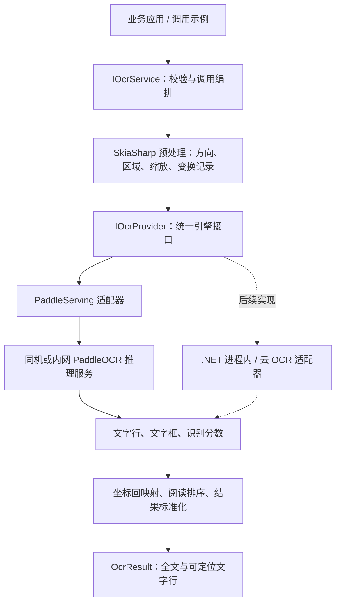

# Bing.Utils OCR 文字识别模块解决方案

日期：2026-10-29
定位：方案设计；文中的新增包、接口、默认值和验收指标均为建议，尚未实现。
已确认需求：通用中英文图片、截图、扫描件；本地/私有化优先，保留云 OCR 扩展。

**建议新增独立的 `Bing.Utils.Ocr` 模块，采用“统一 .NET 接口 + 图像预处理适配器 + 可替换识别引擎”。** 首版通过 HTTP 调用同机或内网部署的 PaddleOCR 服务，优先验证 CPU 方案。业务统一获取文字、文字行、位置和置信度，后续更换引擎时保持调用方式一致。

首版需要部署一个常驻 OCR 推理进程或容器，因此交付物包含 NuGet 包、固定版本的服务部署配置和调用示例。如果后续要求“仅安装 NuGet、无需额外进程”，再通过同一引擎接口接入 .NET 进程内实现。两种部署方式共享结果契约，但模型加载、内存占用和运行环境分别管理。

**当前项目已有可复用的图像能力，真正缺少的是识别引擎和 OCR 结果契约。**

| 现有基础 | 核对结果 | 对设计的影响 |
| --- | --- | --- |
| [SkiaSharpHelper.Ocr.cs](/D:/Bing_Framework/Bing.Utils/src/Bing.Utils.Drawing.SkiaSharp/Bing/Drawing/SkiaSharpHelper.Ocr.cs) | 灰度、二值化、去噪、裁边、横纵投影和简单切分 | 可作为可选预处理；不能直接输出识别文字 |
| [ImageSharpHelper.Ocr.cs](/D:/Bing_Framework/Bing.Utils/src/Bing.Utils.Drawing.ImageSharp/Bing/Drawing/ImageSharpHelper.Ocr.cs) | 提供对应预处理能力 | 作为另一图像适配器的复用基础 |
| [ImagePipeline.cs](/D:/Bing_Framework/Bing.Utils/src/Bing.Utils.Drawing.Shared/Bing/Drawing/Internal/ImagePipeline.cs) | 已有方向校正、裁切、缩放、旋转等通用处理 | OCR 仍需新增几何变换记录及坐标回映射 |
| 现有 OCR 预处理入口 | 同步操作，部分处理分配多份与像素数相关的数组 | OCR 入口需要独立限制字节数、像素数和并发 |
| [common.props](/D:/Bing_Framework/Bing.Utils/common.props) | 多目标为 net8.0、net7.0、net6.0、netstandard2.0 | 核心与首版客户端沿用公共构建配置 |

现有通用图像管线的资源限制不能直接视为所有 `*Helper.Ocr` 方法的保证。当前裁边和投影切分结果也不携带原图位置，直接串联这些方法会丢失文字框回映射所需的信息。

**首版面向“识别并取出文字”，把可交付能力收敛到以下范围。**

| 能力 | 首版设计 | 后续扩展 |
| --- | --- | --- |
| 输入 | 单张 PNG、JPEG、BMP；Stream 为主入口，提供文件路径便捷方法 | WebP、多页 TIFF、PDF |
| 语言 | 简体中文、英文、数字、常用标点及混排 | 繁体、竖排及更多语言按独立样本验收 |
| 场景 | 截图、印刷体扫描件、常规拍照文字 | 手写、弯曲文档、复杂背景专项优化 |
| 返回值 | 全文、按序文字行、每行四点框、可用的识别置信度 | 字词级坐标、段落和版面结构 |
| 区域识别 | 调用方指定矩形区域；结果映射回原始显示图 | 多区域任务和模板 |
| 方向处理 | EXIF 方向校正；显式 0/90/180/270 度旋转 | 自动页面方向识别、倾斜检测与矫正 |
| 输出 | 结构化结果；示例提供 UTF-8 TXT、JSON 导出 | 可搜索 PDF、表格及业务系统导出 |
| 批量处理 | 调用方逐张调用，示例展示有界处理 | 专用批量接口、进度、逐项失败与恢复 |
| 扩展接口 | 首发私有化引擎适配器 | 云 OCR 与 .NET 进程内适配器 |

发票金额、身份证字段、合同条款等属于后续业务提取层。它们应消费 OCR 结果并保留来源位置。表格恢复需要额外的结构识别能力，单纯按空格拼接文字无法形成可靠的行列结构。

**引擎建议以 PaddleOCR 私有化服务作为首发实现。** 官方已经提供基于 PaddleX 的服务化部署方式，适合由 .NET 客户端跨进程调用；本方案据此将模型运行环境隔离到 OCR 服务中。[官方服务部署文档](https://www.paddleocr.ai/main/en/version3.x/inference_deployment/serving/serving.html)

| 路线 | 适合的情况 | 本项目的选择 |
| --- | --- | --- |
| PaddleOCR 私有化服务 | 服务端、内网部署、多应用共用模型、独立配置 CPU/GPU | 首发推荐；需维护推理服务 |
| .NET 进程内封装 | 桌面离线工具、单进程部署、希望减少服务运维 | 后续优先评估；按目标运行时和 RID 验证 |
| ONNX Runtime + OCR 模型 | 希望统一推理运行时，并有能力维护 OCR 前后处理 | 可选技术路线；仅引入 ONNX Runtime 不等于完成 OCR |
| Tesseract | 规则、清晰的扫描文本，现有业务已有相关语言包 | 作为样本对照或专项适配器 |
| 云 OCR | 接受联网调用和按量成本，或需特定业务识别能力 | 按需增加适配器，由业务显式选用 |

截至方案日期，官方发布记录已经列出 PaddleOCR 3.7.0 与 PP-OCRv6 的 tiny、small、medium 三档。建议以 **PP-OCRv6 small 作为 CPU 首轮候选**，与 medium 的效果及耗时做样本对比，再锁定实际模型；这是选型建议，不是本项目已经完成的性能结论。[官方发布记录](https://github.com/PaddlePaddle/PaddleOCR/releases/tag/v3.7.0)

.NET 进程内候选可评估 PaddleSharp 和 SimdPaddleOCR：前者封装 Paddle 推理原生库；后者提供托管实现，当前区分 net10.0 与 netstandard2.0 目标。现有仓库使用 .NET 8 SDK，因此尤其要验证实际采用的目标资产及性能，不能套用 .NET 10 路径的效果数据。[PaddleSharp 项目](https://github.com/sdcb/PaddleSharp)、[SimdPaddleOCR 项目](https://github.com/sdcb/SimdPaddleOCR)

ONNX Runtime 官方提供 C# 推理接口，但文字检测框解码、区域裁切、识别解码、词典匹配和阅读顺序仍需要 OCR 实现负责。[ONNX Runtime C# 文档](https://onnxruntime.ai/docs/get-started/with-csharp) Tesseract 官方也强调输入质量和页面切分对结果的影响，适合纳入扫描件对照，不应在没有样本时断言某个引擎普遍最优。[Tesseract 图像质量指南](https://tesseract-ocr.github.io/tessdoc/ImproveQuality.html)

**模块拆分沿用项目已有的核心包、适配包与依赖注入包风格。** 首版建议四个包，命名空间以 `Bing.Ocr` 为主。

| 建议包名 | 职责 | 主要依赖 |
| --- | --- | --- |
| `Bing.Utils.Ocr` | 公共接口、只读结果模型、调用编排、限制校验、阅读顺序与文本拼接 | 基础 .NET API |
| `Bing.Utils.Ocr.SkiaSharp` | 图像识别与解码、EXIF、区域裁切、旋转缩放、坐标变换记录 | Ocr、Drawing.SkiaSharp |
| `Bing.Utils.Ocr.PaddleServing` | HTTP 调用、Paddle 请求/响应转换、协议及能力校验 | Ocr、HttpClient、JSON 序列化依赖 |
| `Bing.Utils.Ocr.DependencyInjection` | 服务注册、配置快照、组件选择和资源生命周期 | Ocr、DI Abstractions |

核心包暴露 `IOcrService`、`IOcrProvider`、`IOcrImagePreprocessor` 三个主要接口。预处理器返回有限大小的编码图片、尺寸及变换信息；Provider 返回处理图坐标下的引擎结果；Service 负责映射为统一结果。

依赖注入包提供 `AddBingOcr`、`AddOcrProvider(factory)` 和 `AddOcrImagePreprocessor(factory)`，采用工厂注册具体适配器，避免依赖注入包反向绑定所有引擎。首版每个服务实例选择一个 Provider。后续需要多个引擎时，在组合根创建具名服务或独立的路由服务。



`Bing.Utils.Ocr` 不暴露 `SKImage`、`Mat` 或 Paddle 特定结果类型。调用方仅引用公共契约即可处理识别结果，图像后端和推理运行时由适配器承担。

**公共 API 以异步识别和只读结果为中心。** 以下为待实现的接口草案：

```csharp
namespace Bing.Ocr;

/// <summary>识别单张图片中的文字，调用结束后保留调用方的输入流。</summary>
public interface IOcrService
{
    /// <summary>从流的当前位置读取图片并执行识别。</summary>
    /// <param name="image">可读图片流；调用期间由调用方保持有效。</param>
    /// <param name="options">本次识别选项；为空时使用服务默认配置。</param>
    /// <param name="cancellationToken">取消排队、传输及可取消的处理步骤。</param>
    /// <returns>包含全文、文字行与坐标的识别结果。</returns>
    Task<OcrResult> RecognizeAsync(
        Stream image,
        OcrOptions? options = null,
        CancellationToken cancellationToken = default);
}
```

接口不要求输入流可 Seek，不关闭调用方传入的流，也不恢复读取位置。文件路径便捷方法自行打开和关闭文件。调用方不得在操作期间修改或提前释放输入流；服务内部产生的图像、缓冲区和 HTTP 响应由服务释放。

建议将配置分为三层，避免每次请求都携带部署细节：

| 配置类型 | 内容 |
| --- | --- |
| `OcrServiceOptions` | 输入字节/像素限制、预处理后字节限制、并发、等待数、总超时 |
| `OcrOptions` | 语言提示、区域、显式旋转、预处理预设、低分提示阈值 |
| `PaddleServingOptions` | 内网服务地址、固定模型配置标识、协议版本及传输限制 |

语言提示按已部署模型能力校验；设置 `zh-Hans+en` 不会自动下载或切换模型。不支持的能力在请求派发前返回明确错误。模型、运行时、设备和推理线程数属于服务部署配置。

假设 `ocr` 已通过依赖注入解析为 `IOcrService`，调用示例如下：

```csharp
// 设计示例；Bing.Ocr 类型及方法待实现。
using var input = File.OpenRead("sample.png");
var result = await ocr.RecognizeAsync(
    input,
    new OcrOptions
    {
        LanguageHint = "zh-Hans+en",
        Preprocessing = OcrPreprocessingPreset.Standard
    },
    cancellationToken);

// 全文采用固定的换行拼接规则，导出文件时显式使用 UTF-8。
File.WriteAllText("sample.txt", result.Text, Encoding.UTF8);

// 界面根据每行 Polygon 标记位置，根据 Confidence 提示低置信度结果。
```

**结果模型需要同时服务于“复制文字”和“在图片上定位文字”。**

| 模型/字段 | 设计契约 |
| --- | --- |
| `OcrResult.SchemaVersion` | 统一结果结构版本，首版为 1 |
| `Status` | `TextDetected` 或 `NoTextDetected`；基础设施失败不伪装为空文字 |
| `Text` | 按 `Lines` 顺序，以 `\n` 拼接；保留行内文字 |
| `ImageWidth / ImageHeight` | EXIF 校正后的完整显示图尺寸，尚未应用 ROI、额外旋转或缩放 |
| `CoordinateSystem` | 固定为 `UprightImagePixels`，与上述尺寸配套 |
| `Lines` | 只读文字行列表，包括顺序、文字、四点框、可用分数和低分标记 |
| `OcrLine.Polygon` | 完整显示图中的浮点像素坐标，四点按顺时针排列 |
| `OcrLine.Confidence` | 可空的 0～1 识别分数；引擎没有提供时为 null |
| `OcrLine.IsLowConfidence` | 根据该 Provider 的阈值计算，供界面提示；不删除原文 |
| `Provider / ModelProfileId` | 标明实际引擎与已固定的模型配置，便于复现 |
| `Elapsed / Warnings` | 耗时及缩放、能力限制等结构化提示 |

置信度不等于准确率。不同引擎的分数不能直接比较；不把缺失值补成 1，也不制造全页“准确率”。识别分数与检测分数分开建模。默认保留引擎返回的低分文字行；适配器显式控制上游识别分数过滤，避免先被上游默认阈值丢弃后再声称完整保留。

首版提供稳定的横排阅读顺序：优先使用经过样本验证的引擎顺序，必要时按行分组后从上到下、从左到右排列。多栏、竖排和复杂表格的阅读顺序属于后续版面能力。字词级坐标仅在引擎真实提供并完成适配时输出，不能将行框等分后充当真实字符位置。

原始识别文字保留大小写、标点和行内空格。简繁转换、号码纠错、正则提取及业务字段归一化放在显式的后处理步骤，并保留原文。

**处理链需要保留几何关系，并让预处理强度适应引擎。**

1. 有界读取输入，识别真实文件格式、帧数和尺寸，在完整像素解码前检查限制。
2. 解码并应用 EXIF 方向，得到统一的完整显示图，作为结果坐标基准。
3. 应用调用方指定的 ROI、旋转和受控缩放，记录每一步变换及其逆变换。
4. 按预设执行必要的像素处理，再编码为有限大小的图片发送给 Provider。
5. 引擎完成文字检测、可选行方向处理和文字识别。
6. Provider 校验响应，转换为处理图坐标下的文字行；Service 按逆变换映射回完整显示图。
7. 保留分数、确定阅读顺序、生成全文并释放中间资源。

`Standard` 预设只做必要的方向、透明背景和尺寸处理，保留彩色信息。`Scan` 预设可以按配置启用轻度对比度增强或去噪。二值化、腐蚀、膨胀等操作作为显式选项，并通过同一批样本比较收益；强制对全部输入二值化可能抹去细笔画或彩色文字。

对新深度学习引擎，直接识别文本行通常比预先逐字符切分更合适。既有投影切分可继续服务专项图像处理需求，不作为通用识别的默认步骤。

坐标以左上角为原点，X 向右、Y 向下。ROI、缩放和旋转采用统一矩阵组合；回映射保留浮点精度。前端按相同 EXIF 方向显示图片，并根据显示缩放比例绘制文字框。用于叠框的图片必须与 `ImageWidth / ImageHeight` 对应。

首版明确关闭服务端整页方向分类和文档展平，整页方向由客户端 EXIF/显式旋转负责。这样可以保持服务端返回坐标的可解释性。后续增加自动方向或透视矫正时，需要补齐相应逆变换；非线性展平需要专门的映射关系，不能套用普通旋转矩阵。

**PaddleServing 适配器应封装官方协议，并固定兼容范围。** 官方基础服务使用 `POST /ocr`、JSON 请求体及 Base64 图片，支持通过 `visualize` 控制是否返回可视化图片。[官方 OCR 服务 API](https://www.paddleocr.ai/main/en/version3.x/pipeline_usage/OCR.html#3-development-integrationdeployment)

建议适配器显式发送以下语义的配置，而不是依赖服务默认值：

```json
{
  "file": "<预处理图片的 Base64 内容>",
  "fileType": 1,
  "useDocOrientationClassify": false,
  "useDocUnwarping": false,
  "useTextlineOrientation": true,
  "textRecScoreThresh": 0.0,
  "visualize": false
}
```

其中行方向模型必须属于已部署的模型组合。配置不支持时在启动校验中暴露，不默默忽略。检测阈值保持为已验收模型配置的一部分；识别分数过滤设为 0 是为了在客户端保留、标记低分识别候选，并不代表检测阶段不存在筛选。

适配器校验 HTTP 状态、业务错误码、结果节点、文字/分数/多边形数组长度、有限数值及尺寸一致性。格式错误转换为 `OcrProviderException`；不得将解析失败返回成空结果。Provider 对外只返回统一模型，上游原始 JSON 留在适配器内部。

`ModelProfileId` 必须对应部署时冻结的模型清单，由受控部署配置提供，并用服务探针核验配置配对；官方响应缺少模型身份时，不把客户端配置值当作服务端已证实的实际版本。

**部署建议从一个 CPU 推理实例起步，并把模型当作部署资产管理。**

| 环境 | 形态 | 使用方式 |
| --- | --- | --- |
| 本机开发 | 本地常驻进程，或 Docker Desktop / WSL2 容器 | .NET 访问 loopback 地址 |
| 私有化服务器 | Linux x64 CPU 容器，先部署一个推理实例 | 应用经内网访问；按负载增加实例 |
| GPU 需求明确后 | 单独配置 GPU 镜像、驱动与运行时组合 | 保持 .NET 调用契约一致 |
| 完全离线 | 预装运行环境、模型、词典和部署配置 | 在断网环境验证启动和识别 |

模型清单记录检测、识别、方向模型、词典、运行时版本、来源及许可文件，并随服务版本固定。服务启动时检查组合可用性，加载并预热后才进入就绪状态；运行中的请求不触发模型下载。模型通过新实例部署和切换升级，避免原地覆盖正在使用的文件。

建议先以 4 vCPU、8 GiB 内存的 CPU 环境进行选型测量。这是评估起点，容量应根据真实输入大小、并发、模型和运行时确定。HTTP 方式会增加编码、Base64、传输与二次解码开销，需要计入端到端耗时和峰值内存。

**资源与失败契约应在首版确定，下面的数值是可配置的初始建议。**

| 配置项 | 建议初值 | 含义 |
| --- | --- | --- |
| 单张编码输入上限 | 10 MiB | 有界读取，超限后停止 |
| 解码像素数上限 | 2000 万 | 在完整像素分配前检查，尺寸乘法使用溢出校验 |
| 单边尺寸上限 | 8192 px | 独立于总像素上限 |
| 预处理后编码上限 | 20 MiB | 控制重编码及 Base64 请求大小 |
| Provider 响应体上限 | 4 MiB | 关闭可视化图片后，限制 JSON 和文字框数量 |
| 客户端活动请求 | 1 | 每个共享服务实例初始串行，测量后调整 |
| 客户端等待请求 | 8 | 在读取/解码前获得容量，满载及时报告繁忙 |
| 单次总超时 | 30 秒 | 覆盖排队、预处理、传输和结果转换 |

Base64 将编码图片体积扩大约三分之一；还需要计算 .NET 字符串、JSON、像素缓冲和服务端解码的额外内存。像素上限并不等价于进程内存硬上限，硬限制应由宿主进程或容器施加。

客户端服务及配置采用共享、线程安全的实例和不可变快照；图像对象与临时数据每次调用独立创建。传入的 HttpClient 由宿主管理；容器创建的组件由容器释放。独立创建服务时明确由创建者负责释放，避免重复释放共享资源。

服务端入口同样需要限制活动推理和等待数量，覆盖所有客户端的总流量。部署模板负责补齐有界准入、进程资源上限和故障回收；这些能力需要单独验收。若多个请求共享一个不可中断的模型实例，先串行执行，再根据实际推理实现决定是否增加实例。

| 情况 | 对调用方的行为 |
| --- | --- |
| 参数不合法 | 标准参数异常 |
| 格式不支持、输入超限或图片损坏 | `OcrInputException`，带稳定错误码 |
| 请求的功能不支持 | `OcrCapabilityException` |
| 识别成功但没有文字 | `NoTextDetected`，空列表和空字符串 |
| 模型服务不可达、响应无效或推理失败 | `OcrProviderException` |
| 本地或服务端容量已满 | `OcrBusyException` |
| 调用方取消 | `OperationCanceledException` |
| 超出服务总期限且非调用方取消 | `OcrTimeoutException` |

取消排队和 HTTP 等待可以及时返回；已经开始的远端或原生推理不一定随之中断。客户端取消后，服务端仍把任务计入活动容量直到计算结束。需要严格停止时，由监督进程回收独占该任务的工作进程；不能仅取消 Task 就视为算力已释放。不可取消的图像原生调用同样要在资源限制和进程隔离层处理。

首版不自动重试识别请求，也不自动切换到云服务，避免超时后重复推理或意外发送图片。未来加入路由时，将允许的 Provider、外发策略、重试预算和切换记录作为显式配置。

服务地址来自受控配置，用户上传入口仅提交文件内容。内网跨主机访问由部署层提供认证与 TLS。默认日志记录请求标识、Provider、模型配置、尺寸、耗时及错误类别；图片与识别全文按业务的明确留存策略处理。

**调用示例建议提供一个最小的识别页面，方便直接验证结果。** 页面包含上传/拖入图片、图片预览、可选区域选择、识别状态、文字框叠加、全文复制和 TXT/JSON 下载。低分文字突出显示，允许人工核对；修改后的文本与识别原文分开保存。

库本身负责识别和结果，示例 Web 宿主负责上传限制、认证、页面状态与下载。首版可以使用普通文件上传接口；批量任务状态、数据库和持久任务队列在出现实际需求时再加入。

**后续扩展按独立职责推进，避免把图片 OCR 变成一套文档平台。**

| 扩展 | 设计方式 |
| --- | --- |
| PDF | 新增文档适配层，优先使用可用文字层；扫描页按受控 DPI 栅格化后调用图片 OCR |
| 多页文档 | 使用独立 `OcrDocumentResult` 包装逐页结果，带页码、页尺寸和单页状态 |
| PDF 坐标 | 保存页面旋转、CropBox 和栅格化变换，处理 PDF 坐标原点与单位差异 |
| 批量任务 | 有界生产/消费，逐项输出成功或失败；取消后停止读取新的任务 |
| 表格/版面 | 引入结构识别模型和独立模型契约，返回行列、单元格或区域关系 |
| 云 OCR | 实现同一 Provider 契约，明确其支持的语言、坐标和分数语义 |
| 业务字段 | 在 OCR 结果上增加字段抽取与校验，并引用文字行和坐标作为来源 |

PDF 的“已有文字层”还需检查可用性，混合页面可按区域补充 OCR并去重。该扩展需独立选取渲染库和验证部署条件，不由首版图片 API 隐式接收 PDF。多帧文件也明确报告当前不支持，不静默只处理第一页。

**验收应同时验证契约、识别质量和部署可用性。** 建议先准备不少于 300 张真实样本，覆盖清晰截图、中英混排、扫描件和困难图片；至少 100 张留作不参与调参的验收集。按场景分层记录，避免一个平均值掩盖某类输入的失败。

| 验收项 | 方式或候选目标 |
| --- | --- |
| 核心契约 | 假 Provider 覆盖输入校验、空结果、错误转换、取消、资源释放与配置快照 |
| 几何一致性 | EXIF、ROI、旋转、缩放组合下的已知点往返误差不超过 1 像素；与识别框定位精度分开考察 |
| 真实推理 | 固定模型在 Windows 开发环境、Linux x64 私有部署上识别同一组样本 |
| 文字质量 | 用人工标注计算 CER = 编辑距离 / 标注字符数，按场景报告 |
| 初始质量目标 | 清晰截图 CER ≤ 2%；常规扫描件 CER ≤ 5%，作为选型目标由样本验证 |
| 排序与定位 | 标注样本核对横排阅读顺序；有文字框标注时报告匹配覆盖率及检测指标 |
| 初始性能目标 | 在记录 CPU 型号、4 vCPU/8 GiB 的测试环境中，预热后、并发 1，1080p 截图端到端 P95 ≤ 2 秒 |
| 资源 | 记录冷启动、模型加载、峰值内存；持续混合负载下内存趋于稳定，满载行为符合契约 |
| 离线与故障 | 断网可启动和识别；模型缺失、服务失联、畸形响应、排队满和超时均可定位 |

质量目标与性能目标是实施前的候选验收线，并非已测结果；扫描页性能另按分辨率和字符密度测量。每次结果记录模型配置、预处理、阈值、硬件和样本集版本。CER 的空白、换行及 Unicode 处理规则预先固定，不能为了降低错误率擅自忽略标点或修改文字。

测试归属建议：核心与 DI 的单元测试放入各自 `*.Tests`；图像解码、真实模型、容器和网络调用放入对应 `*.Tests.Integration`。核心契约和首版客户端沿用仓库公共目标框架构建；netstandard2.0 用实际消费端验证。真实引擎测试固定模型和少量代表样本，完整质量集单独执行，便于区分代码问题与模型效果变化。

**实施建议分四步完成，预算约 11～17 人日。** 该估算以一名熟悉 .NET、具备基本 Python/容器部署能力的开发者，以及已准备好的真实图片和标注为前提；样本采集与大规模标注另计。

| 阶段 | 工作内容 | 交付物 | 估算 |
| --- | --- | --- | --- |
| 选型验证 | small/medium 对比，确认 CPU 环境、语言、质量、协议及坐标语义 | 固定模型组合和样本报告 | 1～2 人日 |
| 核心与图像层 | 契约、输入限制、预处理、几何变换、排序和 DI | Ocr、SkiaSharp、DI 三包 | 3～4 人日 |
| 引擎与部署 | HTTP 适配、真实推理、离线模型、准入限制与部署配置 | PaddleServing 包和部署模板 | 4～6 人日 |
| 示例与验收 | 识别示例、故障与容量验证、NuGet 消费端和文档 | 可试用版本与验收记录 | 3～5 人日 |

首版交付标准是：业务通过一个稳定接口完成本地/内网图片识别，拿到可以叠框核对的结构化结果；部署方能够固定模型、离线启动、限制资源并诊断失败。PDF、云 OCR 和进程内引擎沿已定义的接口继续扩展。
