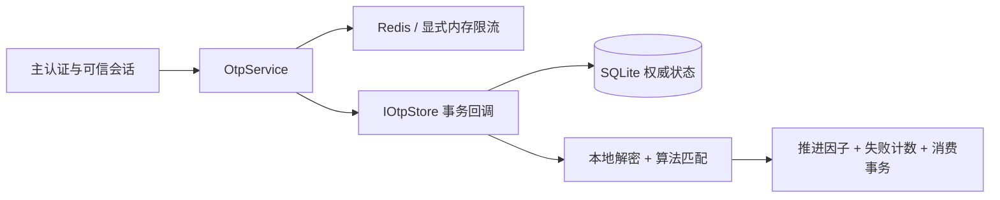

# TOTP/HOTP 动态验证码解决方案

2026-10-29 执行修订版。按用户批准计划同时交付 TOTP/HOTP 完整生命周期。入口见 [模块文档](../../modules/Bing.Utils.OneTimePassword.md)，任务见 [实施计划](../../../ai_docs/tasks/2026-10-29-otp-lifecycle/plan.md)。

## 模块与依赖

五包以 Bing.OneTimePassword 为根命名空间，支持 net8.0/net7.0/net6.0/netstandard2.0，Web 示例使用 net8.0。

| 包 | 职责 |
| --- | --- |
| Bing.Utils.OneTimePassword | 算法、严格 Base32、URI、生命周期、事务存储契约、内存限流 |
| Bing.Utils.OneTimePassword.Sqlite | 权威状态、原子消费、持久失败锁定及有界清理 |
| Bing.Utils.OneTimePassword.DataProtection | 按不可变凭据上下文保护密钥 |
| Bing.Utils.OneTimePassword.Redis | 分布式请求限流 |
| Bing.Utils.OneTimePassword.DependencyInjection | 配置快照、唯一组件注册、启动解析校验 |

核心只依赖 Security 和 DiagnosticSource。复用 SecurityRandom 与 SecureComparison；OTP 内部 SHA1 使用 BCL，通用 HMAC 的 SHA-2 契约保持不变。OTP 单独提供 Base32，不修改通用转换 API。Sqlite/DataProtection.Abstractions 固定 8.0.33，Redis 固定 2.13.1，DI Abstractions 为 8.0.2。

## 事务边界

IOtpStore.ExecuteAsync 在同一非延迟写事务中读取账号、凭据、验证事务，执行同步本地判定并提交全部变更。回调不调用 Redis 或网络服务。**旧方案中的两个独立 CAS 接口由事务契约替代；Redis 不保存重放或计数器权威状态。**

可信 OtpContext 包含账号、固定用途、会话绑定值、近期主认证时间及可信地址；宿主从认证状态构造，不从请求体直接绑定。客户端仅提交凭据 ID、事务 ID 和验证码；服务再次检查归属、用途、会话、状态和有效期。

## 算法与重放

- Hotp.Generate/FindMatch、Totp.Generate/FindMatch 仅执行算法，FindMatch 返回最高匹配因子，不表示认证或消费。
- 默认 SHA1、6 位；TOTP 30 秒、Unix Epoch、前后各一步。支持 SHA256/SHA512、8 位及 30/60 秒；HOTP 的 SHA256/SHA512 属于扩展配置。
- 移动因子使用 8 字节大端序。HOTP 支持完整 ulong，计数器耗尽后拒绝继续，禁止回绕。
- 严格接受指定长度 ASCII 数字并保留前导零。完整计算有界窗口，固定时间比较，候选重复时选择最大因子。
- TOTP 按凭据全局保存 LastAcceptedStep，仅接受更大时间步。**不提供按用途复用或允许重放模式**，修正旧方案关于可重复使用的错误表述。绑定确认也消费因子。
- HOTP 检查 [C,C+5]，成功推进匹配值加一；重同步需要近期主认证和专用事务，在 [C,C+100] 中搜索连续两码，歧义拒绝，两码均消费。

依据：[RFC 4226](https://www.rfc-editor.org/rfc/rfc4226.html)、[RFC 6238 §5.2](https://www.rfc-editor.org/rfc/rfc6238.html#section-5.2)。

## 生命周期

IOtpService 提供 BeginEnrollmentAsync、ConfirmEnrollmentAsync、BeginVerificationAsync、VerifyAsync、GetCredentialsAsync、RevokeAsync、ResynchronizeHotpAsync。

1. 每设备生成独立随机密钥，默认 32 字节，SHA512 为 64 字节。
2. 默认每账号 5 个有效设备、1 个待确认设备。重新绑定替换旧待确认记录，10 分钟过期。
3. 创建绑定时一次性返回 Base32 和 URI；响应丢失后重新绑定，不提供密钥回读。
4. ConfirmEnrollmentAsync 原子激活并消费首码；设备列表只返回脱敏元数据。
5. 主认证后创建默认 5 分钟有效、绑定账号/用途/会话的验证事务；不同设备竞争同一事务只能成功一次。
6. 撤销清除密文并使账号未完成事务失效；撤销提交后无法验证。

每事务默认最多 5 次失败；账号/凭据在 15 分钟窗口累计 5 次失败后锁定 15 分钟。新事务和成功验证不清空当前失败窗口；锁定持久化。

## 密钥与协议

OtpSecretEncoding 输出大写无填充 Base32，严格检查非法字符、长度、尾部位。OtpProvisioningUri 转义发行者/账号，确保标签与查询 issuer 一致，按类型输出 counter 或 period。[Key URI Format](https://github.com/google/google-authenticator/wiki/Key-Uri-Format)

Data Protection 用途分层绑定应用、账号、凭据、类型、算法、位数、周期。密文置换或修改配置会失败。宿主持久化并保护密钥环；轮换保护密钥不改变 OTP 密钥，旧保护 key 保留到凭据重新保护或撤销。

临时明文字节用后清理；密钥、URI、验证码不进入日志、指标、追踪。敏感模型 ToString 不自动展开属性。

## SQLite 与限流

schema v1 保存账号、凭据、验证事务，计数器用 8 字节 BLOB。参数化 SQL、外键、WAL、synchronous=FULL、immediate 写事务，锁等待上限 5 秒。显式 InitializeAsync，未知版本拒绝启动。

异常或提交前观察到取消则回滚；提交后不恢复状态，结果未知不自动重放。CleanupAsync 有界清理过期状态，保留有效凭据重放记录。每应用独占本地数据库文件，不用于多主机网络共享。Task 接口下 I/O 实际同步执行，无 Task.Run。[Microsoft.Data.Sqlite 限制](https://learn.microsoft.com/en-us/dotnet/standard/data/sqlite/async)

Redis 单键 Lua 原子计数、首次设置过期，各维度独立计费，无跨存储事务。默认每分钟 IP 60、账号/凭据/事务各 10、账号管理 5。复用宿主连接、应用前缀隔离；故障拒绝请求，无内存回退。单实例示例显式选择有界内存限流，SQLite 失败锁定仍然有效。

## DI、Web 与验收

DI 复制配置，检查每角色唯一组件，启动解析 IOtpService 完成验证；工厂资源由容器释放。

samples/OtpWeb 使用 HTTPS、Secure/HttpOnly/SameSite Cookie、CSRF 和 no-store，覆盖完整生命周期。Development 演示身份由服务端固定建立；生产须由宿主接入主认证与近期认证策略。OTP 原子提交成功后才签发 MFA 会话。手工密钥和 URI，不引入二维码。

普通验证失败统一 otp_invalid，限流 429，存储/保护故障 503。内部指标只有固定用途、类型、算法、结果标签，区分成功、失败、重放、锁定及故障。

算法/生命周期和模块单测运行 net6/net7/net8；SQLite、Data Protection、Redis、Web 分配独立 Integration 项目。验收包括 RFC 向量、边界、重放、并发、重启、回滚、锁超时、密钥轮换/隔离、CSRF、身份和错误映射。五包打包全部四框架，再用隔离 NuGet 消费者验证。

BING_OTP_REDIS 缺失明确跳过，配置不可达必须失败。CI 覆盖 Windows/Linux，远端结果和本机证据分别记录。本次不提交、不发布、不改发行版本，保留验证码/OCR 工作。恢复码、Passkey、云 KMS、真实账号系统后续接入。
